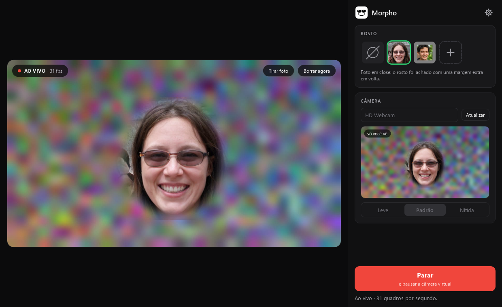

# Morpho

Troca de rosto ao vivo para Windows. O Morpho troca o seu rosto em tempo real na webcam e
entrega a imagem como uma câmera comum ("Morpho Camera") para o Meet, o Zoom, o Discord e
o OBS. Tudo roda no seu computador.

**Página e download: https://morpho.medaumexemplo.com**



*Os rostos das capturas foram gerados por IA; não são de pessoas reais.*

## O que ele faz

- **Ao vivo:** 30 quadros por segundo e cerca de 30 ms de atraso numa RTX 3060 de notebook
  (HyperSwap 256 com TensorRT).
- **Câmera virtual própria:** um filtro DirectShow que aparece como webcam nos outros
  programas. Não precisa de OBS.
- **Proteção do rosto real:** se a troca falhar, a imagem sai borrada em vez de mostrar o
  rosto de verdade; e há um botão de emergência, "Borrar agora".
- **Troca de rosto com um clique**, galeria de fotos e ajustes ao vivo (nitidez,
  intensidade, manter a boca e os olhos reais).
- **Instalador sem administrador** e um **diagnóstico** de 290 KB que diz se o computador
  dá conta antes de baixar os 4 GB.

## Requisitos

| | |
|---|---|
| Sistema | Windows 10 ou 11, 64 bits |
| Placa de vídeo | NVIDIA (GTX 16, RTX 20, 30, 40 ou 50), driver atualizado |
| Memória de vídeo | 6 GB recomendados (4 GB no limite) |
| Memória | 8 GB (16 GB recomendados) |
| Disco | 13 GB livres |

Não funciona com placas AMD ou Intel, nem em Mac. Até agora o desempenho foi medido só
numa RTX 3060 de notebook; nas outras placas é estimativa.

## Baixar

Pela [página](https://morpho.medaumexemplo.com/#baixar): o diagnóstico confere o computador e
baixa o instalador. Os arquivos também estão em
[Releases](../../releases): baixe o `MorphoSetup.exe` e os arquivos `.bin` para a mesma
pasta e abra o `.exe`.

O instalador e o diagnóstico ainda não têm assinatura digital, então o Windows mostra o
aviso "O Windows protegeu o computador". Clique em **Mais informações** e em **Executar
assim mesmo**. A impressão digital (SHA-256) de cada arquivo está na página.

## Como é feito

Dois processos: o **motor** (`app/engine`) captura a câmera, roda a troca e publica os
quadros em memória compartilhada; a **janela** (`app/ui`, PySide6) mostra o resultado e
manda comandos. O motor usa o fork
[beekamai/DeepLiveCam](https://github.com/beekamai/DeepLiveCam) do
[Deep-Live-Cam](https://github.com/hacksider/Deep-Live-Cam).

```
app/            o app (motor e janela)
vendor/morphocam/   a câmera virtual (filtro DirectShow, C++)
packaging/      Morpho.exe, montagem do pacote e roteiro do instalador (Inno Setup)
diagnostico/    o programa de diagnóstico e download (C++)
site/           a página (estática, publicada na Vercel)
bench/          scripts de medição e os resultados que guiaram as decisões
docs/           notas de desenvolvimento e capturas de tela
```

As notas de quem desenvolve (como rodar, remontar o pacote, armadilhas) estão em
[docs/desenvolvimento.md](docs/desenvolvimento.md). Os caminhos que aparecem lá e nos
scripts são os do computador em que o projeto nasceu; para outro lugar, use as variáveis
`MORPHO_ENGINE_ROOT`, `MORPHO_CAMERA_DIR` e `MORPHO_DATA_DIR`.

## Uso responsável

Trocar de rosto ao vivo pode machucar pessoas se for mal usado.

- Use apenas fotos de quem autorizou.
- Não use para se passar por outra pessoa, enganar alguém, burlar verificações de
  identidade ou criar conteúdo que prejudique terceiros.
- Avise quando a imagem estiver alterada.

## Licenças

- **O app e o motor:** [GNU AGPL-3.0](LICENSE), como o Deep-Live-Cam e o fork em que o
  motor se baseia.
- **A câmera virtual** (`vendor/morphocam`): derivada do filtro do
  [Unity Capture](https://github.com/schellingb/UnityCapture), de Bernhard Schelling, sob
  licença MIT.
- **Os modelos** (InsightFace `buffalo_l` e HyperSwap, do FaceFusion): **uso não
  comercial**, de pesquisa e pessoal. Eles vão no instalador, não neste repositório.
- O instalador leva ainda o Python e bibliotecas de terceiros (ONNX Runtime, OpenCV, Qt
  for Python, e as bibliotecas CUDA, cuDNN e TensorRT da NVIDIA), cada uma sob a própria
  licença.
